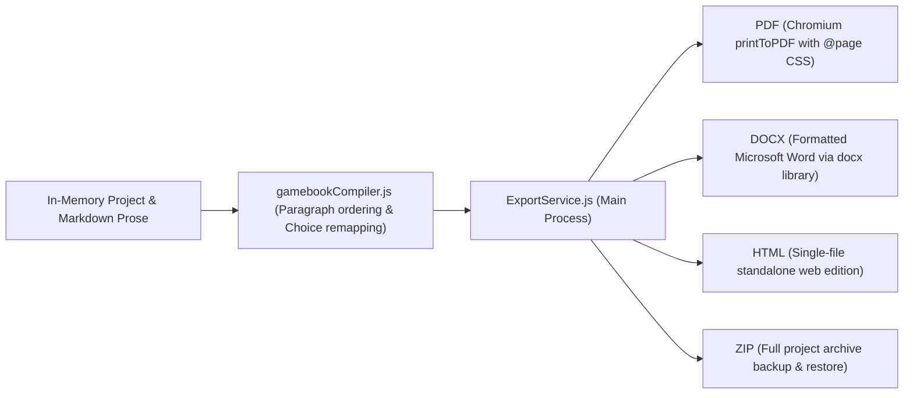

# System Architecture — Gamebook Engine

This document provides a comprehensive technical overview of the **Gamebook Engine** (_Silnik Gier Paragrafowych_). It covers the Electron multi-process model, project directory structure, data flow, layered architecture, data storage models, security mechanisms, publishing subsystem, and build pipeline.

---

## 1. System Overview & Technology Stack

The Gamebook Engine is an advanced desktop application designed for visual and textual authoring of non-linear branching narrative games (gamebooks). It couples visual story graph editing (paragraphs and scenes) with full Markdown prose authoring, rich entity management (NPCs, protagonist, locations, items, traits, combat rules), in-app media editing, live walkthrough simulation, and publication to industry-standard formats (PDF, DOCX, HTML, ZIP).

### Technology Stack:

| Domain | Technology / Tool | Role & Scope |
| :--- | :--- | :--- |
| **Desktop Platform** | **Electron 41** | Multi-process runtime environment (Node.js + Chromium) |
| **Language** | **TypeScript 6** / **JavaScript (ES2020)** | Static typing across Models, ViewModels, Modules, and Utilities |
| **Styling & UI** | **Tailwind CSS v4** (`@tailwindcss/cli`) | Modern, minimalist interface with curated dark theme palette (`#18181b`) |
| **Graph Visualization** | **Cytoscape.js 3.33** + **Web Components** | Node-based story canvas, bezier/curved edge routing, pan/zoom, anti-crossing |
| **Rich Text Editor** | **TipTap 2.x** (`@tiptap/core`) | WYSIWYG Markdown, dialogue blocks, `@` entity mentions, custom text styles |
| **Document Export** | **docx 8.x** + **Chromium printToPDF** | Structured DOCX publishing, print-ready PDF with `@page` styling, standalone HTML |
| **Backup & Archive** | **JSZip 3.x** | Self-contained project zip packaging and automated restoration |
| **Image Processing** | **HTML5 Canvas 2D Engine** | In-app crop, scale, rotate, flip, and real-time color filters (`ImageProcessor.ts`) |
| **Bundler & Build Pipeline** | **esbuild 0.28** (`scripts/build-renderer.js`) | Blazing fast ESM module bundling into `dist/` |
| **Internationalization (i18n)** | **i18next** + `i18next-fs-backend` | Synchronized localization: Polish (`pl`), English (`en`), German (`de`) |
| **Automated Testing** | **Vitest 1.6** + **happy-dom** | Unit, domain logic, IPC handlers, and DOM Web Component tests (76 files, 821 tests) |
| **Code Quality & Tooling** | **ESLint**, **Prettier**, **Husky**, **lint-staged** | Code consistency, static analysis, automated formatting, pre-commit hooks |

---

## 2. Multi-Process Architecture (Electron)

The application strictly adheres to Electron security best practices:
- **`contextIsolation: true`**: Complete isolation between the webpage JavaScript context and Node.js backend.
- **`nodeIntegration: false`**: Eliminates arbitrary Node.js execution within the renderer process.
- All interactions with the local operating system, file system, and native dialogs are channeled exclusively through a typed IPC bridge (`contextBridge`).

```mermaid
graph TB
    subgraph RendererProcess["Renderer Process (Chromium / UI / MVVM)"]
        View["Views (HTML / Tailwind CSS / Web Components)"]
        UIModules["UI Controller Modules (View/ui/*)"]
        GraphModule["Graph Subsystem (Modules/Graph / Cytoscape)"]
        EditorModule["Editor Subsystem (Modules/Editor / TipTap)"]
        ImageEditorModule["Image Processing (Modules/ImageEditor)"]
        ViewModel["ViewModels (ViewModel/*)"]
        DomainModel["Domain Models (Model/*)"]
        FrontendServices["Frontend Services (ProjectManager, GraphValidator)"]

        View --> UIModules
        UIModules --> ViewModel
        UIModules --> GraphModule & EditorModule & ImageEditorModule
        GraphModule --> DomainModel
        ViewModel --> DomainModel
        ViewModel --> FrontendServices
    end

    subgraph PreloadBridge["Secure IPC Bridge Layer (preload.js)"]
        PreloadAPI["contextBridge.exposeInMainWorld('electronAPI', {...})"]
    end

    subgraph MainProcess["Main Process (Node.js / Electron Backend)"]
        Main["main.js (Application Lifecycle & Bootstrap)"]
        WindowManager["main/windowManager.js (BrowserWindow Management)"]

        subgraph IPCDomain["IPC Routers (main/ipc/)"]
            IPCAggregator["index.js (registerAllIpc)"]
            ProjectIPC["projectIpc.js"]
            EntityIPC["entityIpc.js"]
            MarkdownIPC["markdownIpc.js"]
            AssetIPC["assetIpc.js"]
            ExportIPC["exportIpc.js"]
            RecentIPC["recentProjectsIpc.js"]
            AppIPC["appIpc.js"]
        end

        subgraph ServicesDomain["Domain Services (main/services/)"]
            ProjectService["ProjectService.js"]
            EntityService["EntityService.js"]
            MarkdownService["MarkdownService.js"]
            AssetService["AssetService.js"]
            AssetProtoService["AssetProtocolService.js (asset://)"]
            ExportService["ExportService.js"]
            RecentProjectsService["RecentProjectsService.js"]
        end

        subgraph UtilsDomain["Security & Utilities (Utils/)"]
            FSSecurity["Utils/fsSecurity.js"]
            PathSanitizer["Utils/pathSanitizer.js"]
            MainI18n["Utils/i18n.js"]
        end
    end

    subgraph FileStorage["File System Storage"]
        ProjectFile["project.json"]
        AssetFiles["Assets/Images/*"]
        MetaFiles["Category meta.json"]
        ElementFiles["Entity element.json"]
        MarkdownTexts["Narrative Prose (Description_*.md)"]
        UserData["userData (settings.json, recent-projects.json)"]
        ExportOutputs["Export Artifacts (*.pdf, *.docx, *.html, *.zip)"]
    end

    %% Cross-process boundaries
    UIModules & ViewModel -->|Calls window.electronAPI| PreloadAPI
    PreloadAPI -->|ipcRenderer.invoke| IPCDomain

    %% Main process wiring
    Main --> WindowManager
    Main --> IPCAggregator
    IPCAggregator --> ProjectIPC & EntityIPC & MarkdownIPC & AssetIPC & ExportIPC & RecentIPC & AppIPC

    ProjectIPC --> ProjectService
    EntityIPC --> EntityService
    MarkdownIPC --> MarkdownService
    AssetIPC --> AssetService
    ExportIPC --> ExportService
    RecentIPC --> RecentProjectsService

    ProjectService & EntityService & MarkdownService & AssetService & ExportService --> FSSecurity
    EntityService --> PathSanitizer

    ProjectService --> ProjectFile & MetaFiles
    EntityService --> ElementFiles & MetaFiles
    MarkdownService --> MarkdownTexts
    AssetService & AssetProtoService --> AssetFiles
    ExportService --> ExportOutputs & AssetFiles
    RecentProjectsService --> UserData
    MainI18n --> UserData
```



---

## 3. Directory Taxonomy and Codebase Organization

```text
SilnikGierParagrafowych/
├── main.js                     # Main Process entry point & lifecycle events
├── preload.js                  # contextBridge script exposing typed window.electronAPI
├── package.json                # Project dependencies, scripts, engines specification
├── tsconfig.json               # TypeScript compiler configuration
├── vitest.config.ts            # Vitest runner configuration with happy-dom environment
│
├── main/                       # Application Backend (Electron Main Process)
│   ├── windowManager.js        # BrowserWindow instantiation and viewport configuration
│   ├── ipc/                    # IPC channel registration routers
│   │   ├── index.js            # Aggregator: registerAllIpc()
│   │   ├── projectIpc.js       # Project creation, opening, saving, native directory picker
│   │   ├── entityIpc.js        # Entity scaffolding and persistence
│   │   ├── markdownIpc.js      # Safe reading and atomic writing of .md files
│   │   ├── assetIpc.js         # Native image import and asset listing
│   │   ├── exportIpc.js        # Multi-format publication export (PDF, DOCX, HTML, ZIP)
│   │   ├── recentProjectsIpc.js# Recent project tracking
│   │   └── appIpc.js           # Locale switching, OS username detection, graceful exit
│   └── services/               # Pure Node.js business logic and I/O services
│       ├── ProjectService.js   # Project directory scaffolding, project.json & meta.json loader
│       ├── EntityService.js    # Entity creation, directory slugging, element.json updates
│       ├── MarkdownService.js  # Safe reading and transactional atomic write of Markdown files
│       ├── AssetService.js     # Media asset manager and import handler
│       ├── AssetProtocolService.js # Privileged custom asset:// protocol handler
│       ├── ExportService.js    # Document and archive compiler (PDF, DOCX, HTML, ZIP)
│       └── RecentProjectsService.js # Persisting recent project history in userData
│
├── Model/                      # Strongly typed domain entities (TypeScript)
│   ├── Project.ts              # Root project model coordinating scenes, entities, rules
│   ├── Scene.ts                # Scene model (paragraph group, color badge, dimensions)
│   ├── Paragraph.ts            # Story paragraph model (choices, combat, linked entities)
│   ├── Choice.ts               # Player choice / branch between paragraphs
│   ├── Condition.ts            # Branch requirements (textual, traits, inventory)
│   ├── Description.ts          # Unified narrative prose (text, summary, filePath)
│   ├── Location.ts             # Geographic story locations
│   ├── NPC.ts & NPC_Template.ts# Non-Player Characters and template prototypes
│   ├── PlayerCharacter.ts      # Protagonist character sheet model
│   ├── Item.ts                 # Items and inventory elements
│   ├── CharacterClass.ts       # Character classes
│   ├── Combat.ts               # Turn-based combat setup and parameters
│   ├── Stat.ts & Skill.ts & Feature.ts # Stats, skills, and traits rules
│   ├── Parameter.ts            # Dynamic parameters with mathematical formulas
│   ├── Tag.ts                  # Categorization tags with color metadata
│   └── constants.ts            # Domain constants (entity categories, preset colors)
│
├── ViewModel/                  # Presentation and UI state management (MVVM)
│   ├── MainWindowViewModel.ts  # Main editor state: ribbon, drawers, faceted search, history
│   └── StartWindowViewModel.ts # Launcher state: project creation, modal dialogs, i18n
│
├── View/                       # View layer
│   ├── MainWindow.html         # Main editor template (Ribbon, drawer, workspace, sidebar)
│   ├── MainWindow.js           # Main view coordinator (wires UI modules to ViewModel)
│   ├── MainWindow.css          # Input Tailwind CSS v4 source styles
│   ├── MainWindow.generated.css# Compiled production stylesheet
│   ├── StartWindow.html        # Launcher / Welcome window template
│   └── ui/                     # Modular view controllers organized by feature domain
│       ├── assets/             # Asset manager modal, image editor modal, asset picker
│       ├── common/             # Shared HTML templates, confirmation modal, avatar rendering
│       ├── detailsPanel/       # Right property inspector, history bar, combat setup
│       ├── drawer/             # Left drawer entity lists, search, faceted filters
│       ├── editor/             # TipTap Markdown toolbar, custom styles, font browser, entity link
│       ├── graph/              # Cytoscape coordinator, zoom controls, drop zones
│       ├── modals/             # Export modal, hero modal, NPC folio, playtest modal
│       ├── project/            # Project saver, state tracker, autosave service
│       └── workspace/          # Workspace coordinator, top bar toolbar, quick search (Ctrl+K)
│
├── Modules/                    # Self-contained feature modules
│   ├── Graph/                  # Story graph interactive visualization subsystem
│   │   ├── StoryGraph.ts       # Cytoscape coordinator and DOM node synchronization
│   │   ├── StoryGraphStyles.ts # Visual stylesheet, curved edge offsets, anti-crossing logic
│   │   ├── ParagraphNode.ts    # Custom Web Component: <paragraph-node>
│   │   ├── SceneNode.ts        # Custom Web Component: <scene-node>
│   │   └── types.ts            # Drag-and-drop state types and graph configuration options
│   ├── Editor/                 # TipTap Rich Markdown Editor subsystem
│   │   ├── MarkdownEditor.ts   # Core TipTap Markdown Editor implementation
│   │   ├── CustomStylesService.ts # Custom text style management & stylesheet injection
│   │   ├── CustomFontsService.ts  # Google Fonts loader and offline fallback
│   │   └── extensions/         # Custom TipTap extensions (DialogBlock, CustomStyleMark, etc.)
│   └── ImageEditor/            # In-app canvas image processor
│       └── ImageProcessor.ts   # Crop, scale, rotate, flip, and color adjustment filters
│
├── Services/                   # Client-side services (Renderer Process)
│   ├── ProjectManager.ts       # Singleton holding active runtime Project instance in UI
│   └── GraphValidator.ts       # Graph diagnostic engine (orphan, dead-end, loop detection)
│
├── Utils/                      # Utility modules
│   ├── fsSecurity.js           # Path traversal defense, directory resolver, atomic writes
│   ├── pathSanitizer.js        # Diacritic removal, slugification, collision avoidance (Node)
│   ├── pathSanitizer.ts        # Browser-compatible TypeScript sanitizer
│   ├── i18n.js                 # Main process i18next backend configuration
│   ├── translate.ts            # Renderer i18n client (typed keys, reactive language changes)
│   ├── icons.ts                # Custom Web Component <app-icon> with SVG catalog
│   ├── toast.ts                # Floating toast notifications manager
│   └── idGenerator.ts          # Unique ID generators
│
├── Locales/                    # i18n JSON translation bundles
│   ├── pl/translation.json     # Polish
│   ├── en/translation.json     # English
│   └── de/translation.json     # German
│
├── scripts/                    # Build scripts and tooling
│   ├── build-renderer.js       # esbuild compilation script for renderer modules
│   └── check-licenses.js       # Dependency license verification script
│
├── types/                      # Global TypeScript definitions
│   ├── global.d.ts             # Window interface extensions (electronAPI)
│   ├── ipc.d.ts                # Data contract interfaces for IPC payloads
│   ├── viewModules.d.ts        # Ambient module declarations for JS view controllers
│   └── html.d.ts               # HTML string import definitions
│
├── tests/                      # Automated test suite (Vitest — 76 test files, 821 tests)
│   ├── IPC/                    # IPC channel integration and service handling tests
│   ├── Model/                  # Unit tests for domain models and serialization
│   ├── Modules/                # Unit tests for Editor, Graph, and ImageProcessor
│   ├── Services/               # Unit tests for GraphValidator, LinkUpdater, Numbering
│   ├── Utils/                  # Unit tests for path sanitization, i18n, fs security, assets
│   ├── View/                   # DOM node, Web Components, modal and controller tests
│   └── ViewModel/              # ViewModels presentation logic tests
│
└── docs/                       # Architectural documentation
    ├── ARCHITECTURE.md          # Master architecture reference (this document)
    ├── MAIN_PROCESS_ARCHITECTURE.md # Deep dive into the Electron Main Process
    └── FRONTEND_ARCHITECTURE.md # Deep dive into the Renderer, MVVM, and Graph engine
```

---

## 4. File-System Storage Architecture

Projects are persisted directly as clean, human-readable JSON files and standard Markdown documents. This ensures zero vendor lock-in, effortless version control integration (e.g., Git), and simple manual backup or external diffing.

### Project Storage Layout:

```text
[Project Directory]/
├── project.json                        # Primary project manifest file (metadata, styles)
├── Assets/                             # Media assets managed via asset://
│   └── Images/                         # Project illustrations, custom portraits, and maps
├── Paragraphs/                         # Category: Story Paragraphs
│   ├── meta.json                       # Category index referencing element.json paths
│   ├── p_001_prologue/                 # Individual entity folder (unique slug)
│   │   ├── element.json                # Paragraph metadata (id, title, choices, combat, pos)
│   │   └── Description_Paragraph_Prologue.md # Actual narrative prose
│   └── p_002_chamber/
│       ├── element.json
│       └── Description_Paragraph_Chamber.md
├── NPC/                                # Category: Non-Player Characters
│   ├── meta.json
│   └── town_guard/
│       ├── element.json                # Stats, parameters, skills, features, inventory
│       └── Description_NPC_Town_Guard.md
├── Items/                              # Category: Items and Equipment
│   ├── meta.json
│   └── steel_sword/
│       ├── element.json
│       └── Description_Item_Steel_Sword.md
├── Locations/                          # Category: Geographical Locations
│   ├── meta.json
│   └── rose_inn/
│       ├── element.json
│       └── Description_Location_Rose_Inn.md
├── CharacterClasses/                   # Category: Character Classes
│   ├── meta.json
│   └── warrior/
│       └── element.json
├── PlayerCharacter/                    # Category: Protagonist Sheet
│   ├── meta.json
│   └── main_hero/
│       ├── element.json                # Protagonist stats, vital formulas, items
│       └── Description_PlayerCharacter_Main_Hero.md
├── Rules/                              # Category: Mechanics, Stats, Skills, Traits
│   ├── meta.json
│   └── strength/
│       └── element.json
└── Templates/                          # Category: Entity Prototypes & Templates
    └── meta.json
```

### JSON Schema Roles:
- **`project.json`**:
  Stores top-level metadata (`id`, `name`, `author`, `version`), custom text style definitions, and an array of relative `dataPaths` pointing to each category's `meta.json`.
- **`meta.json`**:
  Defines category metadata and an `elements` array containing relative paths to all active `element.json` files within that category.
- **`element.json`**:
  Stores entity-specific properties (e.g. `{ x, y }` positions, choice definitions, locked numbers, tag links, vital parameters, stats, skills, combat setups, and a `description` object referencing relative `Description_<Category>_<Slug>.md` paths).

---

## 5. Architectural Patterns & Data Flow

### 5.1. The MVVM Pattern in the Renderer
The UI layer is structured according to the **Model-View-ViewModel (MVVM)** pattern:
1. **Model** (`Model/*`):
   Pure, self-contained business entities with deterministic invariants. Each class provides static `fromJSON(data)` factory constructors and `toJSON()` serializers.
2. **ViewModel** (`ViewModel/*`):
   Stateful presentation logic decoupled from DOM elements:
   - Ribbon & Top Bar toolbar states.
   - Drawer toggle states and persistent widths (`leftDrawerWidth`, `rightSidebarWidth`).
   - Faceted search algorithms (filtering paragraphs by query, tag, scene, or NPC).
   - Selection history tracking with breadcrumb navigation.
   - Graph visual preferences (curved vs straight lines, zoom sensitivity).
3. **View & UI Controllers** (`View/MainWindow.html`, `View/ui/*`):
   Declarative HTML views styled with Tailwind CSS, driven by modular JavaScript controllers receiving a unified `appContext` (`ctx`).

### 5.2. Runtime Project Singleton (`ProjectManager`)
The renderer manages the active story through `ProjectManager.getInstance()`. It stores the loaded `Project` domain instance and its file-system root path, facilitating coordinated saving, opening, and modifications across all UI components.

---

## 6. Publication and Export Subsystem

The engine features an integrated multi-format publishing pipeline:



- **Paragraph Numbering Shuffle**: Authors can choose to randomize paragraph numbering for physical release. The compiler automatically maps choices from internal entity IDs to randomized book paragraph numbers (e.g. "Go to 42"), ensuring unbroken gameplay continuity.
- **Appendices Generation**: Automatically generates ready-to-use Protagonist Character Sheets, Bestiary / Dramatis Personae (NPCs), combat blocks, and Table of Contents.

---

## 7. Story Graph Diagnostics & Playtester Simulator

- **Graph Validation Engine (`Services/GraphValidator.ts`)**:
  Performs real-time topological analysis detecting:
  - Orphan nodes (unconnected paragraphs).
  - Dead ends (paragraphs without choices and not marked as story endings).
  - Unreachable nodes (disconnected narrative islands).
  - Cycles and infinite loops with visual loop path tracing.
- **Playtester Walkthrough Debugger (`View/ui/modals/playtest/playtestModal.js`)**:
  Allows authors to test their gamebooks interactively directly within the IDE, testing condition branches, stats, vital formulas, dynamic choices, and dice mechanics with step undo capability.

---

## 8. Security Model & Data Integrity

### 8.1. Path Traversal Defense (`isPathInsideBase`)
Desktop applications must never trust renderer-supplied paths. All file operations in `ProjectService`, `EntityService`, `MarkdownService`, `AssetService`, and `ExportService` resolve candidate paths against the validated project root:

```javascript
const { resolveProjectDir, isPathInsideBase } = require('../../Utils/fsSecurity')

const projectDir = resolveProjectDir(projectPath)
const targetPath = path.resolve(projectDir, relativePath)

if (!isPathInsideBase(projectDir, targetPath)) {
    return { success: false, error: 'Unauthorized path access.' }
}
```

This prevents malicious or malformed paths (such as `../../../../Windows/System32`) from accessing or writing files outside the designated project directory.

### 8.2. Transactional & Atomic Writes
To prevent file corruption caused by process termination, sudden power loss, or OS crashes during I/O operations, all JSON and Markdown modifications are written transactionally:
1. Data is written to a temporary sibling file (`name.json.<timestamp>.<random>.tmp`).
2. An atomic file replace is executed via `fs.renameSync(...)`.

---

## 9. Internationalization (i18n)

The engine features a synchronized multi-language architecture supporting English (`en`), Polish (`pl`), and German (`de`):

1. **Main Process (`Utils/i18n.js`)**:
   - Built on `i18next` with `i18next-fs-backend`.
   - Persists user language choices to `userData/settings.json`.
   - Falls back gracefully to the host operating system's locale.
2. **Renderer Process (`Utils/translate.ts`)**:
   - Bundles locale catalogs directly into the ESM bundle for instantaneous response.
   - Provides strongly-typed `t(key)` helper functions.
   - Automatically populates DOM elements via `applyTranslations()` using `data-i18n`, `data-i18n-placeholder`, and `data-i18n-title` attributes.

---

## 10. Build, Linting & Testing Pipeline

The application features an automated, high-velocity developer workflow:

```bash
# Launch development mode (Tailwind CSS + TypeScript check + esbuild + Electron):
pnpm start

# Build production assets:
pnpm build

# Watch renderer TypeScript files with esbuild:
pnpm renderer:watch

# Execute the complete Vitest test suite (76 test files, 821 tests):
pnpm test:run

# Lint and auto-format the codebase:
pnpm lint:fix
pnpm format
```

---

## 11. Documentation Index

- Detailed technical guide for the Electron Main Process, IPC routers, and services:  
  - [Main Process Architecture (MAIN_PROCESS_ARCHITECTURE.md)](MAIN_PROCESS_ARCHITECTURE.md)
- In-depth guide for the UI architecture, MVVM layer, and Cytoscape graph subsystem:  
  - [Frontend Architecture (FRONTEND_ARCHITECTURE.md)](FRONTEND_ARCHITECTURE.md)
