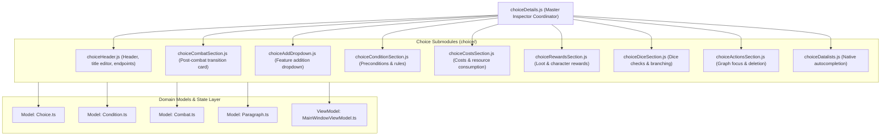

# Choice Details Panel Subsystem Architecture (`View/ui/detailsPanel/choice/`)

This document outlines the architecture, component decomposition, data flow, and design principles of the **Choice Subsystem** (`Choice`) within the right-hand property inspector (`detailsPanel`) of the Gamebook Engine.

---

## 1. Subsystem Architecture & Data Flow

The choice subsystem decouples the narrative connection inspector (`choiceDetails.js`) into 9 specialized, loosely coupled, and thoroughly unit-tested modules:

---

## 2. Module Cheatsheet & Test Coverage

| Module                      | UI Responsibility                                                                                                         | Primary Exports                                                                         | Automated Tests                             |
| --------------------------- | ------------------------------------------------------------------------------------------------------------------------- | --------------------------------------------------------------------------------------- | ------------------------------------------- |
| `choiceHeader.js`           | Breadcrumb header, live inline text renaming, target paragraph selector dropdown, source/target endpoint badges           | `createChoiceHeader`, `resolveChoiceEndpoints`, `renderChoiceEndpointsBadgeHtml`        | `ChoiceHeader.test.ts` (23 tests)           |
| `choiceCombatSection.js`    | Read-only encounter badge, opponent avatar list, and battle origin links for post-combat narrative branches               | `createChoiceCombatSection`, `resolveChoiceCombatData`, `handleGoToCombat`              | `ChoiceCombatSection.test.ts` (16 tests)    |
| `choiceConditionSection.js` | Dynamic requirement builder supporting items, stat thresholds (with math operators), tag flags, and custom prose rules    | `createChoiceConditionSection`, `detectConditionType`, `createConditionInstance`        | `ChoiceConditionSection.test.ts` (25 tests) |
| `choiceCostsSection.js`     | Upfront choice costs (item deductions, health/stat sacrifices) with prompt dialogs, badge previews, and bulk removal      | `createChoiceCostsSection`, `getChoiceCosts`, `setChoiceCosts`, `addChoiceCost`         | `ChoiceCostsSection.test.ts` (27 tests)     |
| `choiceRewardsSection.js`   | Narrative rewards and loot (item grants, stat bonuses) with formatted empty states and interactive addition dialogs       | `createChoiceRewardsSection`, `getChoiceRewards`, `setChoiceRewards`, `addChoiceReward` | `ChoiceRewardsSection.test.ts` (27 tests)   |
| `choiceDiceSection.js`      | Skill test configuration (tested stat, roll modifier, multi-threshold result branches, and alternative graph targets)     | `createChoiceDiceSection`, `getChoiceDiceCheck`, `getDiceCheckBranches`                 | `ChoiceDiceSection.test.ts` (23 tests)      |
| `choiceAddDropdown.js`      | Accessible popover dropdown for attaching optional gameplay features with click-outside dismissal and keyboard navigation | `createChoiceAddDropdown`, `CHOICE_FEATURE_OPTIONS`, `handleFeatureSelection`           | `ChoiceAddDropdown.test.ts` (12 tests)      |
| `choiceActionsSection.js`   | Bottom action bar: smooth Cytoscape graph centering and safe choice deletion workflow with modal confirmations            | `createChoiceActionsSection`, `handleShowGraph`, `handleDeleteChoice`                   | `ChoiceActionsSection.test.ts` (15 tests)   |
| `choiceDatalists.js`        | Injects invisible `<datalist>` elements providing native browser autocomplete for items, stats, parameters, and tags      | `ensureChoiceDatalists`, `extractItemNames`, `extractStatNames`, `extractTagNames`      | `ChoiceDatalists.test.ts` (17 tests)        |

---

## 3. Deep-Dive Component Specifications

### 3.1. `choiceHeader.js`

- **Role:** Mounts at the top of the choice inspector, presenting choice identity and connection endpoints.
- **Key Capabilities:**
    - `resolveChoiceEndpoints(choice, ctx)`: Safely resolves the source node (`fromParagraphId`) and target node (`toParagraphId`), retrieving their friendly titles or falling back to IDs.
    - **Live Inline Renaming:** Synchronizes input changes on both `input` and `blur/Enter` events. Instantly triggers `storyGraphInstance.updateChoiceLabel` to keep the Cytoscape graph edge labels in sync with the input field.
    - **Target Paragraph Selector:** Dynamic `<select>` element enabling authors to remap choice jump destinations or decouple them into unconnected branches.
    - **XSS Defense:** Escapes all dynamic node titles and choice labels via `escapeHtml`.

### 3.2. `choiceCombatSection.js`

- **Role:** Informational preview rendered only when a choice originated from a turn-based combat encounter (`choice.isCombatOutcome`).
- **Key Capabilities:**
    - Detects the combat outcome type (e.g. victory, escape, defeat) and renders status badges (`bg-emerald-950/40`, `bg-rose-950/40`).
    - Displays participating opponents from `ctx.projectMonsters` with their visual avatars (`getAvatarById`).
    - Provides a "Go to combat setup" shortcut button to jump directly into the source paragraph's battle configuration.

### 3.3. `choiceConditionSection.js`

- **Role:** Precondition rule builder gating choice availability during gameplay.
- **Supported Condition Types:**
    - `item`: Requires a specific quantity of an inventory item (autocompleted via `#choice-items-datalist`).
    - `stat`: Compares character stats or parameters against a threshold using mathematical comparison operators (`≥`, `>`, `=`, `≤`, `<`, `≠`).
    - `tag`: Requires an active narrative flag/tag (e.g. `secret_discovered`).
    - `text`: Free-form author prose condition for custom tabletop RPG mechanics.
- **Architecture Highlights:**
    - Pure function `detectConditionType(condition)` classifies instances across TypeScript class instances (`ItemCondition`, etc.) and plain JSON representations.
    - Factory function `createConditionInstance(...)` constructs valid domain instances.

### 3.4. `choiceCostsSection.js`

- **Role:** Manages upfront resource deductions required to execute a choice (e.g. paying gold, losing stamina, expending consumables).
- **Key Capabilities:**
    - Visual modifier cards with highlighted numerical penalties (e.g. `-15`, `-1x Key`).
    - Addition workflow with input validation modal prompts (`promptAddCost`).
    - Instant item deletion and "Clear all" button (`onRemoveAll`), updating UI lists and firing the `onSave` persistence callback.

### 3.5. `choiceRewardsSection.js`

- **Role:** Manages loot, bonuses, and narrative rewards granted to the player upon choosing an option.
- **Key Capabilities:**
    - Rewarding badge styling (`text-emerald-400`, `border-emerald-700/50`).
    - Clean empty state (`no_rewards`) inviting authors to add initial loot.
    - Interactive prompt allowing authors to award either inventory items or character stat bonuses.

### 3.6. `choiceDiceSection.js`

- **Role:** Configures dice check mechanics (randomized skill checks) linked to the branch.
- **Key Capabilities:**
    - Selection of base test stat (e.g. Agility, Strength) with native datalist suggestions.
    - Difficulty modifier input.
    - Dynamic result branch list (`branches`):
        - Each branch specifies a score threshold (`threshold`), narrative description, and target jump destination (`targetParagraphId`).
        - Adding and removing branches immediately synchronizes graph connections.

### 3.7. `choiceAddDropdown.js`

- **Role:** Progressive disclosure menu allowing authors to attach optional mechanics to a base choice.
- **Interaction & Accessibility:**
    - Groups options into semantic categories: _Preconditions_, _Gain / Loss_, and _Dice Mechanics_.
    - Implements click-outside dismissal and `Escape` key handling.
    - Automatically resets selection (`select.value = ''`) upon picking an item, enabling sequential additions.

### 3.8. `choiceActionsSection.js`

- **Role:** Bottom command bar managing choice lifecycle actions.
- **Key Capabilities:**
    - **Show in Graph:** Switches the workspace to the Cytoscape graph canvas (`setActiveMainView('graph')`) and centers viewport focus on the source paragraph node (`focusOnElement`).
    - **Delete Choice:** Prompts the author with a localized confirmation dialog, removes the connection from the paragraph model, refreshes the graph, updates history, and dismisses the inspector.

### 3.9. `choiceDatalists.js`

- **Role:** Injects hidden `<datalist>` containers once per panel mount to power browser autocompletion.
- **Datalist Registries:**
    - `#choice-items-datalist`: Deduplicated, alphabetically sorted item names from `projectItems`.
    - `#choice-stats-datalist`: Aggregated list of stats, vital parameters, and character skills.
    - `#choice-tags-datalist`: Project-wide tags merged with local paragraph tags.

---

## 4. Engineering Standards & Quality Assurance

1. **Internationalization (i18n):**
    - 100% of labels, placeholders, titles, and prompt dialog strings route through `t(...)`.
    - Locale dictionary keys are synchronized across:
        - `Locales/pl/translation.json`
        - `Locales/en/translation.json`
        - `Locales/de/translation.json`
    - Zero hardcoded natural language strings exist in module source code.

2. **XSS Protection:**
    - All author-provided input and dynamic entity attributes are neutralized with `escapeHtml(...)` before template interpolation.

3. **Accessibility (a11y):**
    - Icon-only buttons include descriptive `aria-label` attributes.
    - Decorative SVGs carry `aria-hidden="true"`.
    - Modifiers and branch collections apply semantic ARIA attributes (`role="list"`, `role="listitem"`).

4. **TypeScript Safety:**
    - Full ambient declarations are maintained in `types/viewModules.d.ts` with strict parameter and return contracts (`IChoiceHeaderResult`, `IChoiceCombatData`, `IChoiceConditionSection`, etc.).

5. **Automated Testing:**
    - Verified via **Vitest** in `tests/View/`: **9 test suites, 185 unit tests passing (100% pass rate)**.
