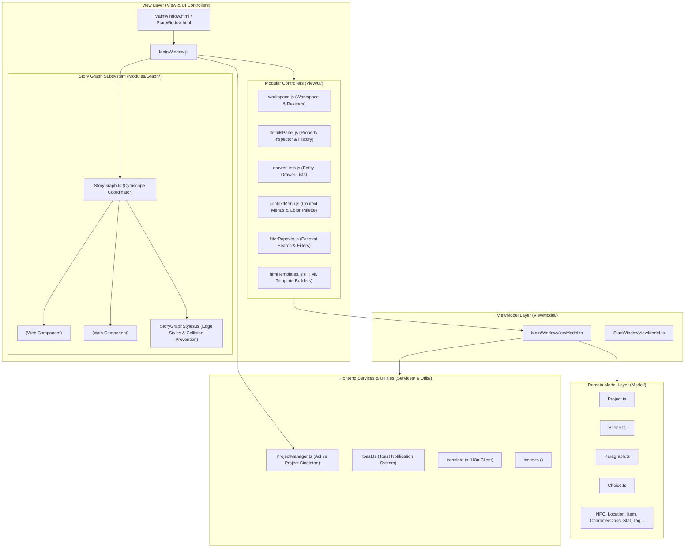

# Frontend Architecture — Gamebook Engine

This document provides an in-depth guide to the presentation layer (Renderer Process) of the **Gamebook Engine** (_Silnik Gier Paragrafowych_). It details the **MVVM** pattern, modular view controllers in `View/ui/`, and the interactive story graph subsystem in `Modules/Graph/` powered by **Cytoscape.js** and **Custom Web Components**.

---

## 1. Frontend Architecture Overview (MVVM)

The renderer process executes inside a sandboxed Chromium instance isolated from Node.js (`contextIsolation: true`, `nodeIntegration: false`). The user interface is structured around the **Model-View-ViewModel (MVVM)** pattern with a modularized view controller architecture.



---

## 2. Domain Models (`Model/`)

Models located in `Model/` are strongly typed TypeScript classes that encapsulate story game entities and business invariants:
- Strict encapsulation (`private` properties with getters/setters).
- `fromJSON(data)` factory constructors to parse data from `element.json` and `project.json`.
- `toJSON()` methods for safe serialization to disk.

### Key Domain Relationships:

```mermaid
classDiagram
    class Project {
        +string id
        +string name
        +string author
        +string version
        +Scene[] scenes
        +Location[] locations
        +NPC[] characters
        +Item[] items
        +CharacterClass[] characterClasses
        +PlayerCharacter playerCharacter
        +Stat[] globalStats
        +Skill[] globalSkills
        +Feature[] globalFeatures
        +Tag[] tagList
        +fromJSON(projectData, entities)
        +toJSON()
    }

    class Scene {
        +string id
        +string name
        +Description description
        +Paragraph[] paragraphs
        +NPC[] characters
        +Location[] locations
        +Tag[] tags
        +string initialParagraphId
        +position: {x, y}
        +number width
        +number height
        +string color
        +boolean isMovementLocked
    }

    class Paragraph {
        +string id
        +number number
        +number randomizedNumber
        +boolean isNumberLocked
        +string title
        +Description content
        +Choice[] choices
        +boolean hasCombat
        +Combat combat
        +Tag[] tags
        +NPC[] characters
        +Location[] locations
    }

    class Choice {
        +string id
        +string name
        +string fromParagraphId
        +string toParagraphId
        +Condition condition
    }

    class Description {
        +string text
        +string summary
        +string filePath
    }

    Project "1" *-- "many" Scene
    Project "1" *-- "many" Paragraph
    Scene "1" o-- "many" Paragraph
    Paragraph "1" *-- "many" Choice
    Paragraph "1" *-- "1" Description
    Scene "1" *-- "1" Description
```

---

## 3. ViewModel Layer (`ViewModel/`)

ViewModels isolate UI presentation state, algorithms, and event handling from direct DOM manipulation:

### 3.1. `MainWindowViewModel.ts`
Coordinates the state of the primary editor window:
- **Ribbon Toolbar State**:
  Tracks the active tab (`glowna` / General, `sceny` / Scenes, `widok` / View).
- **Navigation & Layout State**:
  - `activeLeftTab`: Selected tab in the left collapsible drawer (`paragraphs`, `scenes`, `characters`, `locations`, `stats`, `traits`, `main-character`, `tags`, `connections`, `search`, `settings`, `explorer`).
  - Drawer visibility and persisted resizable panel widths (`leftDrawerWidth`, `rightSidebarWidth`) bounded by min/max constraints.
  - Workspace view mode (`graph` for the visual Cytoscape story graph vs `markdown` for the narrative prose editor).
- **Faceted Search and Filtering**:
  - `searchAndFilterParagraphs(paragraphs, scenes, characters)`: Multi-attribute filtering combining full-text queries with active tag (`selectedFilterTag`), scene (`selectedFilterScene`), and character (`selectedFilterCharacter`) filters. Number-locked paragraphs are automatically sorted to the top.
  - Dedicated search and filtering methods for scenes, characters, locations, traits, and connections.
- **Selection & Breadcrumbs History**:
  - `selectedItem`: The currently inspected entity (`IHistoryItem`).
  - `history`: Breadcrumb navigation stack allowing back/forward jumps between previously inspected entities.
- **Graph Presentation Preferences**:
  - Choice line connection styles (`connectionLineStyle`: `'curved'` | `'straight'`).
  - Zoom sensitivity factor (`zoomSensitivity`).

### 3.2. `StartWindowViewModel.ts`
Manages the project launcher / welcome screen:
- Loads and formats recent projects with relative timestamps.
- Handles project creation modals, validation rules, and default templates.
- Triggers native directory picker dialogs over IPC (`window.electronAPI.chooseFolder()`).
- Coordinates reactive language switching and i18n dictionary reload.

---

## 4. Modular UI Controllers (`View/ui/`)

To prevent bloated monolithic scripts, `View/MainWindow.js` acts as an orchestrator delegating functionality to modular controllers in `View/ui/`:

### 4.1. `workspace.js` — Workspace Management
- **Dual Workspace View**: Toggles smoothly between the interactive story graph canvas (`#graph-view-container`) and the Markdown document editor (`#markdown-editor-view`).
- **Resizers (Splitters)**: Handles mouse drag operations to resize the left drawer and right property sidebar, updating `MainWindowViewModel` widths.
- **Zoom Toolbar**: Controls canvas viewport manipulation (`+`, `-`, fit to screen `fit`, reset `100%`) synchronized with the Cytoscape camera.

### 4.2. `detailsPanel.js` — Property Inspector & History
- Dynamically renders editing forms tailored to the selected entity type (`paragraph`, `scene`, `character`, `location`, `item`, `tag`, `stat`, `choice`).
- Directly updates entity properties (title, prose content, locked numbering, choices, tag attachments, and NPC associations).
- Renders the interactive breadcrumb history bar (`#history-bar`), enabling immediate navigation back to earlier elements.

### 4.3. `drawerLists.js` — Left Drawer Entity Listings
- Renders filtered, searchable lists across all gamebook categories:
  - `renderParagraphsList()`: Paragraph cards with numbers, tag badges, and lock indicators.
  - `renderScenesList()`: Scene cards with color swatches and paragraph counts.
  - `renderCharactersList()`, `renderLocationsList()`, `renderTagsList()`, `renderTraitsList()`, `renderConnectionsList()`.
- Handles item clicks to inspect entities in `detailsPanel` and automatically center the corresponding node in the graph canvas.

### 4.4. `contextMenu.js` — Context Menus & Color Palette
- Context menu dispatcher for nodes, scenes, and empty canvas space.
- Context actions: *Add Paragraph*, *Add Choice*, *Change Scene Color*, *Lock/Unlock Position*, *Duplicate*, *Delete*.
- Built-in color picker modal (`openColorPicker`) with predefined palettes (`PRESET_ENTITY_COLORS`) and real-time preview.

### 4.5. `filterPopover.js` — Advanced Filtering Popover
- Dropdown popover interface allowing multidimensional filtering:
  - Filter by Tag.
  - Filter by Scene.
  - Filter by Associated Character.
- Displays dynamic badge counters indicating the number of active filters.

### 4.6. `htmlTemplates.js` — Reusable HTML Templates
- Generates standardized DOM structures for reusable UI elements: tag pills (`TagPill`), character badges, status pills, and icon buttons.

---

## 5. Story Graph Subsystem (`Modules/Graph/`)

The visual story graph is the core interface of the engine. It utilizes a hybrid architecture combining the performance and mathematical edge routing of **Cytoscape.js** with the flexibility and interactivity of **Custom Web Components**.

### 5.1. Dual-Layer Architecture (Canvas + DOM Layer)

```text
┌────────────────────────────────────────────────────────┐
│ Graph Canvas Container (#graph-canvas-container)       │
│                                                        │
│  Layer 1 (Bottom / Background):                        │
│  Cytoscape.js Canvas (cy)                              │
│  - Edge routing (curved bezier & straight segments)    │
│  - Choice direction arrows                             │
│  - Graph physics, collision detection, pan, and zoom   │
│                                                        │
│  Layer 2 (Top / Interactive):                          │
│  DOM Layer (absolute positioning, pointer-events: none)│
│  - <scene-node> (scene grouping containers)            │
│  - <paragraph-node> (rich interactive HTML cards)      │
│    * pointer-events: auto on cards                     │
│    * Inputs, buttons, tag pills, quick-add forms       │
│    * Connection drag dots for real-time linking        │
└────────────────────────────────────────────────────────┘
```

Cytoscape tracks virtual coordinates and handles edge rendering. The DOM overlay calculates viewport transforms (`transform: translate(...) scale(...)`) so that HTML Web Components precisely match the underlying Cytoscape nodes during pan and zoom.

### 5.2. `<paragraph-node>` Web Component (`ParagraphNode.ts`)
A custom HTML element (`customElements.define('paragraph-node', ParagraphNode)`):
- Displays paragraph number, title, and lock badge.
- Shows assigned tag pills and character/location chips.
- Features an inline quick-add choice form to create branches on the fly without navigating to side panels.
- Includes an output connector dot allowing authors to drag-and-drop a link directly to another paragraph to generate a `Choice` connection in real time.

### 5.3. `<scene-node>` Web Component (`SceneNode.ts`)
A container node representing a scene group:
- Displays scene title with configurable theme accent colors.
- Shows total count of grouped paragraphs within the scene.
- Offers position locking (`isMovementLocked`) to prevent accidental shifts.

### 5.4. Edge Routing & Anti-Crossing Algorithms (`StoryGraphStyles.ts`)
Ensures clean, readable visual graphs even in complex narratives:
- **`calculateCurvedEdgeControlPointDistance`**: Dynamically calculates bezier curve control points so parallel edges between identical nodes never overlap.
- **`calculateEdgeSourceOffsets`**: Spreads source connection points evenly along the paragraph node border based on the total number of outgoing choices.
- **`preventChoiceLineCrossings` / `reorderChoicesToPreventCrossings`**: Analyzes the geometric layout of target nodes and sorts connection anchor points to minimize intersecting lines.

---

## 6. Client Services and Helpers

- **`Services/ProjectManager.ts`**:  
  Singleton storing the active in-memory `Project` instance and its file-system path. Provides `getProject()`, `getProjectPath()`, `load(projectData, entities, path)`, and `clear()`.
- **`Utils/icons.ts`**:  
  Custom Web Component `<app-icon name="...">` that injects optimized SVG vector icons (save, edit, lock, delete, zoom, tags, etc.).
- **`Utils/toast.ts`**:  
  Non-intrusive floating notification toast utility (`showToast({ message, type, duration })`) supporting `info`, `success`, `warning`, and `error` states.
- **`Utils/translate.ts`**:  
  Renderer-side i18n client offering typed translation keys (`TranslationKey`) and automatic DOM binding via `applyTranslations()`.

---

## 7. Frontend Testing Strategy

The presentation layer is covered by automated unit and integration tests using **Vitest** and **happy-dom**:
- **Domain Model Tests** (`tests/Model/`): Validates entity creation, mutations, choice management, and complete deserialization via `Project.fromJSON()`.
- **ViewModel Tests** (`tests/ViewModel/`): Validates search algorithms, drawer toggling, history navigation, and launcher validation rules without spinning up Electron windows.
- **View & DOM Tests** (`tests/View/`): Verifies Web Component lifecycle events (`<paragraph-node>`, `<scene-node>`), HTML template instantiation, and edge collision algorithms in `StoryGraphStyles`.
