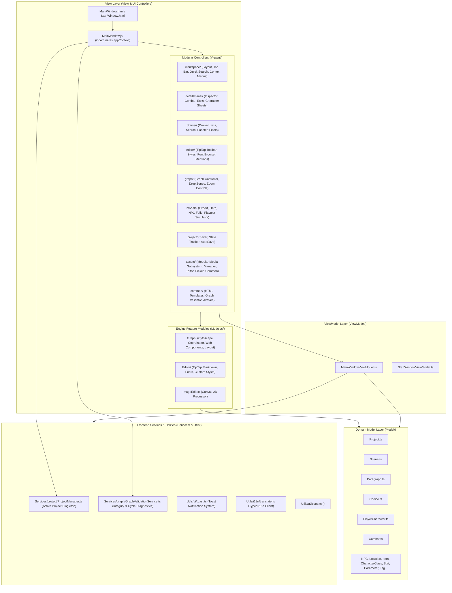
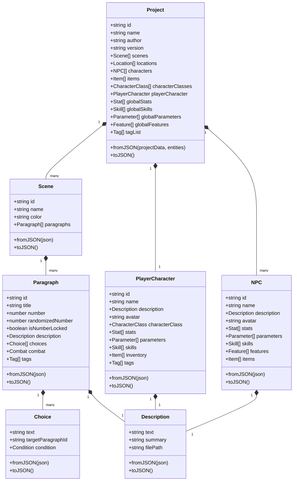

# Frontend Architecture — Gamebook Engine

This document provides an in-depth guide to the presentation layer (Renderer Process) of the **Gamebook Engine** (_Silnik Gier Paragrafowych_). It details the **MVVM** pattern, modular view controllers in `View/ui/`, the interactive story graph subsystem in `Modules/Graph/` powered by **Cytoscape.js** and **Custom Web Components**, the TipTap Rich Markdown Editor, the in-app Image Editor, and the Publication & Export subsystem.

---

## 1. Frontend Architecture Overview (MVVM)

The renderer process executes inside a sandboxed Chromium instance isolated from Node.js (`contextIsolation: true`, `nodeIntegration: false`). The user interface is structured around the **Model-View-ViewModel (MVVM)** pattern with a modularized view controller architecture organized by domain.



---

## 2. Domain Models (`Model/`)

Models located in `Model/` are strongly typed TypeScript classes that encapsulate story game entities and business invariants:

- Strict encapsulation (`private` properties with getters/setters).
- `fromJSON(data)` factory constructors to parse data from `element.json` and `project.json` (supporting Polish legacy schemas).
- `toJSON()` methods emitting clean English schemas for safe serialization to disk.

### Key Domain Relationships:



---

## 3. ViewModel Layer (`ViewModel/`)

ViewModels isolate UI presentation state, algorithms, and event handling from direct DOM manipulation:

### 3.1. `MainWindowViewModel.ts`

Coordinates the state of the primary editor window:

- **Top Bar Toolbar & Ribbon State**:
  Tracks active views, dirty tracking status, and tool selections.
- **Navigation & Layout State**:
    - `activeLeftTab`: Selected tab in the left collapsible drawer (`paragraphs`, `scenes`, `characters`, `locations`, `stats`, `traits`, `main-character`, `tags`, `connections`, `search`, `settings`, `explorer`).
    - Drawer visibility and persisted resizable panel widths (`leftDrawerWidth`, `rightSidebarWidth`) bounded by min/max constraints.
    - Workspace view mode (`graph` for Cytoscape story canvas vs `markdown` for TipTap prose editor).
- **Faceted Search and Filtering**:
    - `searchAndFilterParagraphs(paragraphs, scenes, characters)`: Multi-attribute filtering combining full-text queries with active tag (`selectedFilterTag`), scene (`selectedFilterScene`), and character (`selectedFilterCharacter`) filters. Number-locked paragraphs are automatically sorted to the top.
    - Dedicated search and filtering methods for scenes, characters, locations, traits, and connections.
- **Selection & Breadcrumbs History**:
    - `selectedItem`: The currently inspected entity (`IHistoryItem`).
    - `history`: Breadcrumb navigation stack allowing back/forward jumps between previously inspected entities.
- **Graph Presentation Preferences**:
    - Choice line connection styles (`connectionLineStyle`: `'curved'` | `'straight'`).
    - Zoom sensitivity factor (`zoomSensitivity`).

### 3.2. `StartWindowViewModel.ts`

Manages the project launcher / welcome screen:

- Loads and formats recent projects with relative timestamps.
- Handles project creation modals, validation rules, and default templates.
- Triggers native directory picker dialogs over IPC (`window.electronAPI.chooseFolder()`).
- Coordinates reactive language switching and i18n dictionary reload.

---

## 4. Modular UI Controllers (`View/ui/`)

To maintain high code modularity and maintainability, `View/MainWindow.js` acts as an orchestrator delegating functionality to domain-based modules in `View/ui/`:

### 4.1. `workspace/` — Workspace & Toolbar

- **`topBar.js`**: Upper toolbar containing action groups: Project & Files, Edit & History, Views & Panels, Graph Diagnostics, Testing & Export, Tools & Settings.
- **`workspace.js`**: Dual workspace coordinator (toggling between Cytoscape graph canvas and TipTap Markdown editor), splitter drag controllers for left and right panels.
- **`quickSearch.js`**: Fast keyboard-driven command palette (`Ctrl+K` / `Cmd+K`) searching across paragraphs, scenes, NPCs, items, locations, and markdown text content.
- **`contextMenu.js`**: Canvas and node right-click menus, color picker palette modal (`openColorPicker`).

### 4.2. `detailsPanel/` — Property Inspector & Sub-modules

- **`detailsPanel.js`**: Master inspector controller rendering forms based on active entity type.
- **`combatModule.js` & `combat/`**: Turn-based combat parameters editor with enemy statistics, victory/defeat redirects, and TipTap markdown synchronization.
- **`choiceDetails.js` & `choice/`**: Outgoing choices, story graph branching, requirements, and dice mechanics inspector _(comprehensive guide and specification: [`CHOICE_SUBSYSTEM.md`](CHOICE_SUBSYSTEM.md))_:
    - **`choiceHeader.js`**: Header card displaying choice identity, inline choice text editor, target paragraph selector dropdown, and bidirectional source-to-target jump badges.
    - **`choiceCombatSection.js`**: Read-only combat outcome badge, opponent avatar preview, and battle details when a choice represents a post-combat branching path.
    - **`choiceConditionSection.js`**: Dynamic precondition builder with support for item requirements, stat/parameter thresholds (with mathematical operators), tag flags, and custom author text conditions.
    - **`choiceCostsSection.js`**: Choice requirements and upfront costs (inventory item consumption, stat/health deductions) with modal prompt inputs and instant removal.
    - **`choiceRewardsSection.js`**: Choice rewards and loot granted upon selection (inventory item additions, stat/parameter bonuses) with empty state rendering.
    - **`choiceDiceSection.js`**: Stat-based dice checks (d6/d20/custom formula) with threshold branches, target paragraph overrides, modifiers, and graph synchronisation.
    - **`choiceAddDropdown.js`**: Accessible popover menu for progressively adding optional choice features (Conditions, Costs, Rewards, Dice Checks) with click-outside dismissal.
    - **`choiceActionsSection.js`**: Choice deletion workflows with confirmation modals and focus-in-graph navigation buttons.
    - **`choiceDatalists.js`**: Autocomplete `<datalist>` containers for project items, character stats/parameters/skills, and narrative tags.
- **`exitsModule.js`**: Paragraph exit links overview and jump target manager.
- **`heroReadOnlyDetails.js` & `npcReadOnlyDetails.js`**: Quick-preview cards in right sidebar for characters.
- **`historyBar.js`**: Horizontal breadcrumb navigation bar of recently visited entities.

### 4.3. `drawer/` — Left Entity Navigation

- **`drawerLists.js`**: Searchable, categorized lists of paragraphs, scenes, protagonist, NPCs, templates, locations, items, traits, and tags.
- **`drawerSearch.js`**: Text filter and search input handlers.
- **`filterPopover.js`**: Faceted filter popover with multi-criteria badges (tags, scenes, characters).

### 4.4. `editor/` — TipTap Rich Markdown Subsystem

- **`mainEditor.js`**: Mounts and controls the active TipTap instance.
- **`editorToolbar.js`**: Formatting buttons (headings, bold, italic, underline, lists, quotes, dialogs, image upload).
- **`customStylesMenu.js` & `customStyleModal.js`**: Managing project-specific CSS text styles.
- **`fontBrowserModal.js`**: Google Fonts browser with offline fallback selection.
- **`entityLinkModal.js`**: Popover for creating and editing bidirectional `@` entity mentions and grammatical aliases.
- **`heroEditor.js` & `npcEditor.js`**: Narrative chronicle drawers embedded inside character modals.

### 4.5. `graph/` — Story Graph Coordinator

- **`storyGraphController.js`**: Wires Cytoscape events to MVVM selection and navigation.
- **`graphZoomControls.js`**: Floating zoom controls (`+`, `-`, fit, 100%).
- **`graphDropZone.js`**: Drag & drop target handling for visual linking.

### 4.6. `modals/` — Specialized Functional Modals

- **`export/` (`exportModal.js`, `gamebookCompiler.js`)**: Publication wizard compiling PDF, DOCX, HTML, and ZIP archives with character sheets and paragraph shuffling.
- **`hero/` (`heroModal.js`, `heroSaver.js`)**: Protagonist creation and configuration modal with vital parameter formula evaluator.
- **`npc/` (`npcModal.js`, `npcCharacterSaver.js`)**: NPC Folio modal with archetype templates and stats.
- **`playtest/` (`playtestModal.js`)**: Interactive walkthrough debugger with condition checking, dice roller, and rollback history.

### 4.7. `assets/` — Media & Image Subsystem

Decomposed into modular, single-responsibility subpackages with backward-compatible root facades:

- **`common/`** (`assetPathResolver.js`, `assetDropZone.js`, `assetCardTemplate.js`, `index.js`):
    - `assetPathResolver.js`: Safe project path resolution via `appContext` (`ctx.projectPath` / `ctx.getProjectPath()`) without mutating `window`.
    - `assetDropZone.js`: Drag-and-drop setup for image files with validation and auto-import.
    - `assetCardTemplate.js`: Reusable gallery cards with format badges and `formatFileSize()`.
- **`picker/`** (`assetPickerGrid.js`, `assetPickerModal.js`, `index.js`):
    - `assetPickerGrid.js`: Real-time query search and thumbnail grid rendering.
    - `assetPickerModal.js`: Reusable image picker dialog with native disk import (`importImageNative`) and `Escape` key support.
- **`manager/`** (`assetManagerModal.js`, `assetManagerGrid.js`, `assetDetailPanel.js`, `assetRenameDialog.js`, `assetDeleteDialog.js`, `index.js`):
    - `assetManagerModal.js`: Coordinator for the central asset gallery modal.
    - `assetManagerGrid.js`: Gallery filtering by category/query, sorting by date/name/size, and total library size calculation.
    - `assetDetailPanel.js`: Sidebar inspector displaying metadata, image dimensions with race-condition guard (`_currentLoadingPath`), and entity usage badges.
    - `assetRenameDialog.js`: Custom rename modal dialog with character validation and project-wide reference refactoring.
    - `assetDeleteDialog.js`: Safe asset deletion dialog with warnings when assets are actively referenced in nodes or NPCs.
- **`editor/`** (`imageEditorModal.js`, `imageEditorState.js`, `imageEditorCrop.js`, `imageEditorCanvas.js`, `imageEditorSave.js`, `index.js`):
    - `imageEditorState.js`: Pure data models for aspect ratio calculations, rotation bounds, and transformation clamping.
    - `imageEditorCrop.js`: Interactive cropping overlay with 8 handles; strictly mounts mouse listeners on drag and releases them on mouseup, eliminating memory leaks.
    - `imageEditorCanvas.js`: 2D preview canvas applying affine transforms, mirroring, and CSS color filter adjustments.
    - `imageEditorSave.js`: Detects MIME types/quality and saves modified files via IPC.
    - `imageEditorModal.js`: Coordinator managing editor lifecycle, with `setContext(ctx)` to eliminate stale context bugs.
- **Root Facades (`assetPicker.js`, `assetManagerModal.js`, `imageEditorModal.js`, `index.js`)**: Thin backward-compatible re-exports preserving existing signatures for `topBar.js`, `mainEditor.js`, and external modules.

### 4.8. `project/` — Persistence & Autosave

- **`projectSaver.js`**: Serializes full project payload for `save-full-project`.
- **`projectStateTracker.js`**: Computes dirty state hashes to detect unsaved modifications.
- **`autoSaveService.js`**: Non-blocking periodic autosave with visual debounce.

### 4.9. `common/` — Shared Infrastructure & UI Helpers

- **`graphValidator.js`**: Adapter/facade for `GraphValidationService` providing validation reports on story graph structural integrity (unreachable paragraphs, broken jumps, dead ends, and cycles).
- **`htmlTemplates.js`**:
    - `escapeHtml(str)`: Centralized XSS sanitizer neutralizing HTML entities (`&`, `<`, `>`, `"`, `'`).
    - `getTypeBadgeColor(type)`: Case-insensitive Tailwind class resolver for entity badges (paragraphs, scenes, characters, items, choices, etc.).
    - `getTypeIconSvg(type, extraClasses)`: SVG icon generator for entity types.
    - `PRESET_COLORS`: Frozen array of 12 curated hexadecimal palette colors for tags and scenes.
    - `renderColorPresetButtonsHtml(presetColors, currentColor)`: Safe color picker preset button renderer with active ring indicators.
    - `renderEmptyPlaceholderHtml(iconText, message)`: Standardized empty state container with icon and escaped message.
- **`npcAvatars.js`**:
    - `FANTASY_AVATARS`: Frozen catalog of 10 classic tabletop RPG archetype avatars (Warrior, Mage, Rogue, Cleric, Ranger, Paladin, Bard, Necromancer, Druid, Merchant) with inline SVG vectors.
    - `getAvatarById(id)`: Resolves avatar definitions by ID or relative asset path (`isCustomAvatarPath`), safely generating `` for custom portraits.
    - `getAvatarName(avatar)`: Null-safe localized display name resolver with multi-level fallbacks.

---

## 5. Story Graph Subsystem (`Modules/Graph/`)

The visual story graph is powered by Cytoscape.js coupled with Custom Web Components, organized into focused subpackages:

- **`core/`** (`StoryGraph.ts`): Orchestrates viewport state, canvas event routing, Cytoscape pan/zoom synchronization, drag-and-drop link creation, multi-selection marquee, and typed combat outcome edges.
- **`nodes/`** (`ParagraphNode`, `SceneNode`): Custom Web Components (`<paragraph-node>`, `<scene-node>`) with HTML templates and typed DOM element factories. Fully localized via `Locales/{pl,en,de}/translation.json` (`graph.end_node_badge`, `graph.node.combat`).
- **`styles/`** (`StoryGraphStyles.ts`): Theme tokens (`GRAPH_THEME`), accessible contrast calculation (`getContrastTextColor`), unbundled bezier edge routing with dynamic fanout, and crossing prevention algorithms.
- **`types.ts` & `index.ts`**: Unified configuration interfaces and facade entry point consumed by `scripts/build-renderer.js`.

```text
┌────────────────────────────────────────────────────────┐
│ Graph Canvas Container (#graph-canvas-container)       │
│                                                        │
│  Layer 1 (Background): Cytoscape.js Canvas             │
│  - Curved bezier & straight edge routing               │
│  - Choice direction arrows & connection anchor spacing │
│  - Physics, collision prevention, pan, and zoom        │
│                                                        │
│  Layer 2 (Foreground): DOM Overlay Web Components      │
│  - <scene-node> (grouping boundaries)                  │
│  - <paragraph-node> (interactive HTML cards)           │
│    * Quick choice creation inputs                      │
│    * Real-time drag-and-drop connection handles        │
└────────────────────────────────────────────────────────┘
```

---

## 6. Frontend Testing Strategy

The presentation layer is thoroughly covered by automated unit and integration tests using **Vitest** and **happy-dom**:

- **88 test files, 975 automated tests passing.**
- **Domain Model Tests** (`tests/Model/`): Validates entity creation, mutations, choice management, and deserialization via `Project.fromJSON()`.
- **ViewModel Tests** (`tests/ViewModel/`): Validates search algorithms, drawer toggling, history navigation, and launcher validation rules without spinning up Electron windows.
- **View & DOM Tests** (`tests/View/`): Verifies Web Component lifecycle events (`<paragraph-node>`, `<scene-node>`), HTML template instantiation, and UI controller interactions.
- **Feature Module Tests** (`tests/Modules/`): Tests TipTap Markdown parsing, image processing algorithms, and custom style sanitization.
