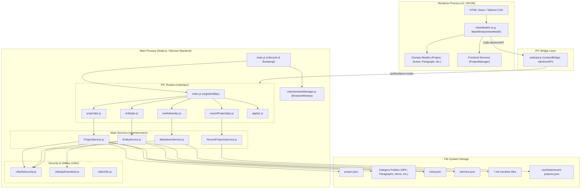

# Main Process Architecture & Modularization Guide

This document describes the modular architecture of the **Electron Main Process** in the Gamebook Engine (_Silnik Gier Paragrafowych_).

---

## 1. High-Level Architectural Overview

The application follows the Electron multi-process model with strict process isolation and a layered architecture in the Main process:



> [!NOTE]
> For a full end-to-end overview across all application layers, see [System Architecture](ARCHITECTURE.md). For details on the UI and renderer subsystem, see [Frontend Architecture](FRONTEND_ARCHITECTURE.md).

---

## 2. Directory and File Structure

```text
/
├── main.js                         # Application bootstrap & lifecycle (~25 lines)
│
├── main/
│   ├── windowManager.js            # BrowserWindow creation & window management
│   │
│   ├── ipc/                        # IPC dispatchers (Electron IPC <-> Services)
│   │   ├── index.js                # Aggregator (registerAllIpc)
│   │   ├── projectIpc.js           # choose-folder, create-project, open-project
│   │   ├── entityIpc.js            # create-entity, save-entity
│   │   ├── markdownIpc.js          # read-markdown-file, save-markdown-file
│   │   ├── recentProjectsIpc.js    # get-recent-projects
│   │   └── appIpc.js               # i18n, get-system-username, close-app, load-main-window
│   │
│   └── services/                   # Pure Node.js domain & filesystem services
│       ├── ProjectService.js       # Project creation, verification, project.json & meta.json loading
│       ├── EntityService.js        # Entity creation, directory scaffolding, unique slugging, element.json saving
│       ├── MarkdownService.js      # Safe reading and atomic writing of narrative markdown files
│       └── RecentProjectsService.js# Management of recent projects list in userData
│
└── Utils/
    ├── fsSecurity.js               # Path traversal protection, directory resolver, atomic writes
    ├── pathSanitizer.js            # Diacritic removal, slugification, unique candidate generation (Node.js)
    └── i18n.js                     # Main process internationalization helper (i18next backend)
```

---

## 3. Module Responsibilities

### 3.1. Application Entry (`main.js`)

- Initializes global application lifecycle hooks (`whenReady`, `activate`, `window-all-closed`).
- Initializes internationalization backend (`initI18n()`).
- Calls `registerAllIpc()` to register all IPC channels before window instantiation.
- Calls `createMainWindow()` to show the primary UI window.

### 3.2. Window Manager (`main/windowManager.js`)

- Configures `BrowserWindow` options (bounds, minimum resolution, window frame, background color, dark theme defaults).
- Attaches the secure preload script (`preload.js`) with `contextIsolation: true` and `nodeIntegration: false`.
- Maximizes and displays `View/MainWindow.html`.

### 3.3. IPC Layer (`main/ipc/`)

Translates incoming `ipcRenderer.invoke(channel, payload)` calls from the renderer into service invocations:

- **`projectIpc.js`**: Integrates Electron `dialog.showOpenDialog` for directory selection and delegates project creation/loading to `ProjectService`.
- **`entityIpc.js`**: Bridges entity creation and updates to `EntityService`.
- **`markdownIpc.js`**: Bridges narrative `.md` file reading and writing to `MarkdownService`.
- **`recentProjectsIpc.js`**: Fetches recent projects via `RecentProjectsService`.
- **`appIpc.js`**: Handles locale switching, translation payloads, system username detection, navigation and graceful application exit.
- **`index.js`**: Single entry point `registerAllIpc()` to maintain clean registration without scattering IPC hooks.

### 3.4. Services Layer (`main/services/`)

Pure Node.js business logic that operates independently of Electron IPC objects:

- **`ProjectService`**:
    - `createProject(projectDetails)`: Generates directory hierarchy (`NPC`, `Paragraphs`, `Items`, `Locations`, `Templates`, `CharacterClasses`, `Rules`, `PlayerCharacter`), generates `meta.json` files for each category, saves `project.json`, and registers the project in recent list.
    - `openProject(targetPath)`: Validates path safety, parses `project.json`, reads all related `meta.json` records, parses each `element.json`, and returns structured entity data (supports backward compatibility with legacy Polish schema keys).
- **`EntityService`**:
    - `createEntity(options)`: Generates collision-free folder slug names, writes initial `element.json` with `{ text, summary, filePath }`, creates standardized `Description_<Category>_<Name>.md` markdown references, and updates the category `meta.json` elements list atomically.
    - `saveEntity(payload)`: Atomically updates an existing `element.json` file.
- **`MarkdownService`**:
    - `readMarkdownFile(payload)`: Reads `.md` narrative text files within project boundaries; returns virtual empty state when file does not exist yet.
    - `saveMarkdownFile(payload)`: Atomically writes markdown files, creating parent directories on demand.
- **`RecentProjectsService`**:
    - Manages reading, writing, and deduplicating the list of recently opened projects inside Electron's `userData` folder.

### 3.5. Security & Utility Layer (`Utils/fsSecurity.js`)

Centralized path validation and transactional write operations:

- `resolveProjectDir(projectPath)`: Resolves project root directory whether given a file (`project.json`) or folder path.
- `isPathInsideBase(basePath, targetPath)`: Canonical directory traversal protection. Verifies that the resolved target path begins with the resolved base directory path.
- `validateProjectData(data)`: Validates `project.json` schema integrity.
- `atomicWriteStringSync(targetPath, content)`: Writes to a temporary `.tmp` file and atomically renames it to `targetPath`.
- `atomicWriteJsonSync(targetPath, data)`: Serializes and atomically persists JSON.

---

## 4. Security Model & Data Integrity

### Path Traversal Defense

In desktop applications, renderer inputs must never be trusted blindly. All file operations in `ProjectService`, `EntityService`, and `MarkdownService` validate target paths against the project root using:

```javascript
if (!isPathInsideBase(projectDir, targetPath)) {
    return { success: false, error: 'Unauthorized path.' }
}
```

This prevents malicious inputs like `../../../../Windows/System32` or attempts to escape the project root directory.

### Atomic File Writes

To prevent file corruption during sudden power failures, crashes, or process terminations, all JSON and Markdown modifications are written to a temporary sibling file (`*.tmp`) before performing an atomic replace (`fs.renameSync`):

```
Write -> file.json.169300000.tmp -> fs.renameSync -> file.json
```

---

## 5. Testing Strategy

Because business logic has been extracted into `main/services/` and `Utils/fsSecurity.js`, services can be unit-tested directly using **Vitest** without initializing Electron browser windows or mocking `ipcMain`:

```typescript
import { ProjectService } from '../main/services/ProjectService'
import { isPathInsideBase } from '../Utils/fsSecurity'

describe('ProjectService', () => {
    it('creates project directory hierarchy and meta.json files', async () => {
        const result = await ProjectService.createProject({
            name: 'Test Gamebook',
            projectPath: tempDir,
        })
        expect(result.success).toBe(true)
    })
})
```

---

## 6. Guide: Adding a New IPC Channel and Service

To add a new capability (e.g. `export-gamebook`):

1. **Implement Domain Logic in Service**:
   Create or edit a service in `main/services/` (e.g., `ExportService.js`):

    ```javascript
    class ExportService {
        static async exportToHtml(projectPath, outputPath) {
            // ... business logic ...
            return { success: true }
        }
    }
    module.exports = ExportService
    ```

2. **Register IPC Handler**:
   In `main/ipc/projectIpc.js` (or a dedicated `exportIpc.js`):

    ```javascript
    ipcMain.handle('export-gamebook', async (_event, payload) => {
        return await ExportService.exportToHtml(payload.projectPath, payload.outputPath)
    })
    ```

3. **Expose in Preload Bridge**:
   In `preload.js`:

    ```javascript
    contextBridge.exposeInMainWorld('electronAPI', {
        // ...
        exportGamebook: (projectPath, outputPath) =>
            ipcRenderer.invoke('export-gamebook', { projectPath, outputPath }),
    })
    ```

4. **Update TypeScript Definitions**:
   In `types/global.d.ts`, add the typed method to `Window['electronAPI']`.

5. **Write Unit Tests**:
   Create a unit test in `tests/` verifying `ExportService` logic directly.
